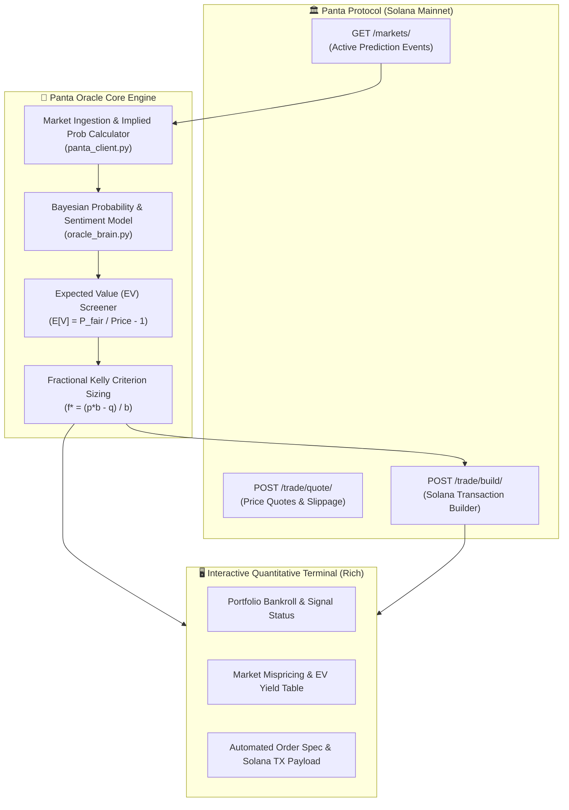

# 🔮 Panta Oracle Agent

> **Autonomous Prediction Market Intelligence & Trading Agent on Solana**  
> *Built for the [Colosseum Crypto World's Fair](https://earn.superteam.fun/earn/hackathon/crypto-worlds-fair) — [Panta API Sidetrack](https://earn.superteam.fun/listings/bounties/panta-api-side-track).*

[](#)
[](#)
[](#)
[](https://opensource.org/licenses/MIT)

---

## 🎯 Overview

**Panta Oracle Agent** is an autonomous quantitative intelligence and trading system designed for **Panta Markets** on Solana. 

Prediction markets contain high-signal crowd intelligence, but individual retail traders frequently suffer from behavioral biases (such as favorite-longshot bias, liquidity mispricing, and sentiment lag). **Panta Oracle Agent** connects to the **Panta Markets API**, continuously scans active binary prediction contracts, evaluates Bayesian fair probabilities, detects statistically mispriced contracts (positive Expected Value $\mathbb{E}[V] > 10\%$), and computes mathematically optimal stake allocations using the **Fractional Kelly Criterion**.

Finally, it builds ready-to-sign Solana transaction payloads to execute primary market buy orders directly on-chain via the Panta Protocol.

---

## 🏗️ Architecture



---

## ✨ Key Features

1. **📡 Automated Panta Market Screener:**
   * Automatically queries active prediction markets across Solana ecosystem events, crypto prices, tech milestones, and macroeconomics.
   * Derives real-time market-implied probabilities from YES and NO contract share prices.

2. **💡 Bayesian Fair-Value Model & EV Scanner:**
   * Flags markets where the true event likelihood deviates significantly from current market quotes.
   * Filters strictly for trades with positive Expected Value:
     $$\mathbb{E}[V] = \frac{P_{\text{fair}}}{\text{Price}_{\text{market}}} - 1 > \text{Threshold}$$

3. **⚖️ Quarter-Kelly Position Sizing:**
   * Prevents portfolio ruin and maximizes long-term geometric capital growth using the Kelly Formula:
     $$f^* = \frac{b \cdot p - q}{b}$$
   * Implements strict safety guardrails (maximum 15% bankroll allocation per market).

4. **⚡ Solana On-Chain Transaction Builder:**
   * Constructs transaction instructions according to Panta API specs (`POST /trade/quote/` and `POST /trade/build/`).
   * Produces base64 wire transactions ready for signing via Solana wallets (Phantom / Backpack / Solflare).

---

## 🚀 Quickstart Guide

### 1. Installation

```bash
git clone https://github.com/Overloade1212/panta-oracle-agent.git
cd panta-oracle-agent

# Create and activate virtual environment
python3 -m venv venv
source venv/bin/activate

# Install dependencies
pip install -r requirements.txt
```

### 2. Configure Panta API Key (Optional)

```bash
cp .env.example .env
```

```env
# Panta Markets API Key (from https://docs.panta.market/)
PANTA_API_KEY=your_panta_api_key_here
PANTA_API_BASE_URL=https://live-api.panta.market/api/v1
```

### 3. Run the Agent

#### Demo Showcase Mode:
```bash
python agent.py --demo
```

#### Custom Bankroll ($5,000) & Strict 15% Edge:
```bash
python agent.py --bankroll 5000 --min-ev 0.15
```

---

## 🧪 Testing

Run the automated quantitative test suite:

```bash
python tests/test_oracle.py
```

Expected output:
```text
✅ All Panta Oracle Agent unit tests passed successfully!
```

---

## 📜 Project Structure

```text
PantaOracleAgent/
├── config.py             # Panta endpoints, risk thresholds & RPC config
├── oracle_brain.py       # Bayesian inference, EV math & Kelly Criterion formulas
├── panta_client.py       # Panta REST client & Solana transaction builder
├── ui.py                 # Rich Terminal dashboard & trade execution card
├── agent.py              # CLI entry point
├── requirements.txt      # Dependencies (rich, aiohttp, python-dotenv)
├── .env.example          # Environment variables template
├── tests/
│   └── test_oracle.py    # Automated unit tests
└── README.md             # Project documentation
```

---

## 👨‍💻 Author

* **Anatoli Kolotovkin** ([@Overloade1212](https://github.com/Overloade1212))
* Submission for **Superteam Earn — Colosseum Crypto World's Fair Hackathon (Panta Sidetrack)**

## 📄 License

This project is licensed under the MIT License - see the [LICENSE](LICENSE) file for details.
